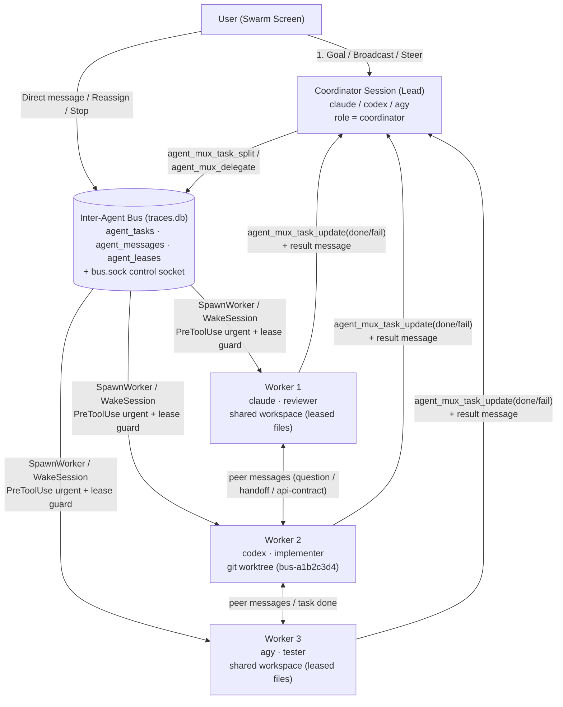

# Agent Swarm Screen (`Mode::Swarm`) — design

Status: draft, 2026-10-29. Section 3 (the four-quadrant layout) and its keys in section 6 are superseded by `2026-10-30-swarm-mission-control-ux-design.md`.

## 1. Why

`agent-mux` already ships the **Inter-Agent Bus** (`src/bus/`, schema `v16` in `src/tracing/store/schema.rs`):
- Peer discovery across live `claude`, `codex`, and `agy` sessions (`bus::store::list_peers`).
- Point-to-point and broadcast messaging (`agent_messages`) with mid-turn urgent injection via `PreToolUse` hooks (`bus::store::drain_urgent_for_hook`) and idle PTY wakeups over the Unix control socket (`ControlRequest::WakeSession`).
- A shared workspace task board (`agent_tasks`) with dependency tracking, shared vs. git-worktree isolation (`TaskIsolation`), and cooperative file leases (`agent_leases`) enforced by `tracing::hooks::guard::bus_lease_verdict`.
- Dynamic lead-to-worker delegation (`ControlRequest::SpawnWorker` / `agent_mux_delegate`).

However, operating a multi-agent swarm today requires jumping back and forth between individual session panes in `Mode::Main` or running CLI commands (`agent-mux bus tasks`, `agent-mux bus recv`) in a separate terminal. You cannot see the **Coordinator**, the **Workers**, the **Task Board + File Leases**, and the **Live Inter-Agent Message Feed** together on one screen, nor can you launch a pre-wired Coordinator + Worker swarm from a single goal prompt.

The **Swarm** screen (`Mode::Swarm`, `ActionId::Swarm`, `F1` → **Open swarm**, CLI `agent-mux swarm …`) provides a dedicated mission-control screen for launching, observing, steering, and debugging a coordinator-led swarm of agents in real time.

---

## 2. Core Concepts & Swarm Topology



### 2.1 Roles in a Swarm

1. **Coordinator (1 per workspace swarm)**:
   - A traced interactive session (`claude`, `codex`, or `agy`) designated as the swarm lead for the workspace.
   - Launched with the built-in `coordinator` persona (`agents/builtin/coordinator.toml`) or promoted from any existing session in the workspace (`c` on a session in `Mode::Swarm`).
   - Receives `$AGENT_MUX_SWARM_ROLE=coordinator` and an opening prompt that instructs it to:
     1. Inspect the workspace and break the user's goal into scoped subtasks (`files`, `target_harness`, `target_agent`, `isolation`) via `agent_mux_task_split` or spawn workers directly via `agent_mux_delegate`.
     2. Monitor progress and answer worker questions arriving on `agent_mux_recv_messages(wait_ms = 30000)`.
     3. Review worker results/diffs (merging worktree branches when `isolation = "worktree"`), verify tests, and synthesize the final outcome.
2. **Workers (`N` concurrent sessions)**:
   - Either dynamically spawned by the Coordinator via `agent_mux_delegate` (`ControlRequest::SpawnWorker`) or pre-launched by the user into the workspace pool (`n` in `Mode::Swarm`).
   - Receive `$AGENT_MUX_SWARM_ROLE=worker`, `$AGENT_MUX_BUS_PARENT_LAUNCH=<coordinator_launch_id>`, and `$AGENT_MUX_TASK_ID=<task_id>`.
   - Communicate **both vertically** (reporting status/blockers to the Coordinator) and **horizontally** (discovering peers via `agent_mux_list_peers` and exchanging `topic = "api-contract" | "question" | "handoff" | "urgent"` messages directly with sibling workers via `agent_mux_send_message`).
3. **Human Operator (User)**:
   - Watches all agents, tasks, file leases, and messages live from `Mode::Swarm`.
   - Can broadcast a steering instruction to the entire swarm or send a direct message (`urgent = true`, `wake = true`) to the Coordinator or any individual Worker without leaving the Swarm screen.
   - Can zoom/attach into any agent's live terminal (`Enter`) and return to `Mode::Swarm` (`Esc` or `F1` → **Open swarm**).

---

## 3. UI & Layout (`src/app/swarm_view.rs`, `src/ui/swarm.rs`)

`Mode::Swarm` uses a four-quadrant mission-control layout with a live mini-terminal preview and a bottom steering bar:

```text
┌─ Swarm — ~/workspace/agent-mux (1 Coordinator · 3 Workers · 4/6 Tasks · 5 Leases) ───────────────────┐
│ [1] Agents (Roster)                        │ [2] Live Terminal Preview: Worker 2 (codex · 8f31a2c0)  │
│ ★ Coordinator                              │ $ cargo test --lib bus::store::tests                    │
│ ● claude (coordinator)   working  12t $0.42│ running 14 tests                                        │
│   └─ "Reviewing Worker 1 schema migration" │ test bus::store::tests::acquire_and_conflict ... ok     │
│                                            │ test bus::store::tests::urgent_drain ... ok             │
│ ⇄ Workers (3 active, cap 4)                │                                                         │
│ ● W1 claude (architect)  working   6t $0.18│ ● Calling tool: agent_mux_send_message                  │
│   task #t-901a  [2 leases: src/bus/**]     │   to: W1 (claude · 4a19b0e1)  topic: "api-contract"     │
│ ▸ ● W2 codex (implementer) working 9t $0.11│   "Updated BusTask schema with swarm_id; ready for UI"  │
│   task #t-44bc  [wt: bus-44bc]   1 unread  │                                                         │
│ ◦ W3 agy (skeptic)       idle 1m   4t $0.05│ [Enter: attach full pane · Space: peek output/diff]     │
│   task #t-77ef  [done ✓]                   │                                                         │
├────────────────────────────────────────────┼─────────────────────────────────────────────────────────┤
│ [3] Task Board & File Leases (l toggle)    │ [4] Inter-Agent Message Feed (f filter: All)            │
│ ● RUNNING (2)                              │ 11:32:04  ★ Coord → *          [plan]                   │
│   #t-901a  Add swarm view state  → W1      │   Split goal into 4 tasks (#t-901a..#t-77ef).           │
│            leases: src/app/swarm_view.rs   │ 11:32:19  W1 → W2              [api-contract]           │
│ ▸ #t-44bc  Wire bus store queries → W2 [wt]│   SwarmSnapshot struct settled in src/bus/mod.rs.       │
│ ◦ OPEN / BLOCKED (1)                       │ 11:32:41  W2 → ★ Coord         [question · urgent !]    │
│   #t-88d0  Write UI tests (needs #t-901a)  │   Should cancelled tasks release worktrees immediately? │
│ ✓ DONE (3)                                 │ 11:32:48  ★ Coord → W2         [reply · wake ⚡]        │
│   #t-77ef  Audit keymap bindings → W3      │   Yes, prune worktree on cancel unless dirty.           │
├─ m message selected · b broadcast · n new task/worker · x stop · Enter attach · Tab pane · ? help ───┤
└──────────────────────────────────────────────────────────────────────────────────────────────────────┘
```

### 3.1 Pane 1 — Agents Roster (`[1]`, Top-Left)

- **Coordinator Card (`★`)**:
  - Shows the active Coordinator session (or an empty slot `[Press c to launch Coordinator or promote a session]`).
  - Displays harness badge (`claude`, `codex`, `agy`), persona, runtime state (`● working`, `◦ idle`, `! waiting`, `✗ exited`), turn count, token/cost rollup, active tool call, and unread message badge.
- **Workers List (`⇄`)**:
  - Lists all worker sessions participating in the workspace swarm (sessions with `GroupKind::Bus` in the workspace, sessions holding tasks/leases in `agent_tasks`/`agent_leases`, or sessions explicitly added to the swarm).
  - Per-worker row shows:
    - Short worker label (`W1`, `W2`, …) + harness + persona/agent name + 8-char `launch_id`.
    - Live status indicator (`●`, `◦`, `!`, `✗`) and elapsed time / cost.
    - Assigned task ID + title, isolation badge (`[shared · N leases]` or `[wt: <branch>]`), and unread bus messages count.

### 3.2 Pane 2 — Live Terminal / Diff Inspector (`[2]`, Top-Right)

- Renders a live, read-only viewport of the currently selected agent's `vt100::Parser` screen buffer (or the selected task's assigned worker when Pane 3 is focused), plus its live trace strip (latest tool call / turn status).
- Pressing `Space` cycles the preview between:
  1. **Live Terminal** (the agent's live PTY output).
  2. **Task Spec & Result** (full instructions, scoped files, and JSON/Markdown result or error for the selected task).
  3. **Git Diff** (when the worker runs in a git worktree or holds file leases, renders `git diff` of its touched files/branch).
- Pressing `Enter` on an agent attaches directly to that session in `Mode::Main` (setting `command_origin` / return breadcrumb so `⌘Enter` / `ReturnToSession` or `F1` → **Open swarm** returns immediately).

### 3.3 Pane 3 — Task Board & File Leases (`[3]`, Bottom-Left)

- Toggles between **Tasks View** and **Leases View** with `l`:
  - **Tasks View** (grouped by `Running`, `Open / Claimed`, `Done`, `Failed / Cancelled`):
    - Shows task short ID, title, assigned worker (`→ W2`), isolation mode (`[wt]` or leased file count), and dependency state (`needs #t-901a`).
    - Allows the user to create a new task (`n`), edit instructions/files (`e`), cancel/stop a task (`x`), or delegate/spawn a worker for an `open` task (`r`).
  - **Leases View**:
    - Lists every active cooperative file/glob lease in `agent_leases` for the workspace: pattern (`src/ui/**`), owning worker (`W1 · claude`), associated task (`#t-901a`), and TTL remaining (`24m left`).
    - Pressing `d` on a stuck lease force-releases it (with a `y/n` confirmation).

### 3.4 Pane 4 — Live Inter-Agent Message Feed (`[4]`, Bottom-Right)

- Chronological stream of `agent_messages` in the workspace, showing:
  - Timestamp, sender (`★ Coord`, `W1`, `W2`, or `User`), arrow `→`, recipient (`*` broadcast, `★ Coord`, `W1`, …), topic badge (`[plan]`, `[api-contract]`, `[question]`, `[result]`, `[urgent !]`), and delivery/ack status (`✓ acked`, `⚡ woke PTY`, `⏳ unread`).
  - Pressing `f` cycles the feed filter:
    1. **All workspace messages**
    2. **Selected agent only** (messages sent to or from the highlighted agent in Pane 1)
    3. **Questions & Urgent only** (`topic IN ('question', 'urgent', 'blocker')`)
- Pressing `Enter` on a message expands its full body and, if it references a file path or Markdown doc, lets you open it.

### 3.5 Inline Steering & Launch Composer (Bottom Bar / Modal)

- **Start Swarm (`New Swarm` dialog, opened via `n` when no Coordinator exists or `R` to start a fresh swarm)**:
  - Fields:
    1. **Goal / Mission Prompt** (multiline `TextArea`, `Ctrl+O` for `$EDITOR`).
    2. **Coordinator Harness & Persona** (defaults to `claude` + `coordinator`).
    3. **Worker Pool Strategy**:
       - *Auto-delegate* (Coordinator spawns workers on demand via `agent_mux_delegate`, up to `max_workers`, default `4`).
       - *Pre-warmed pool* (immediately spawns `N` worker sessions with chosen harnesses/personas—e.g. `1x claude (architect)`, `2x codex (implementer)`, `1x agy (reviewer)`—waiting on the bus).
    4. **Default Isolation**: `Shared (cooperative file leases)` or `Worktree (isolated git branch per task)`.
- **Message / Broadcast Bar (`m` or `b`)**:
  - `m` opens a compact inline composer addressed to the currently selected agent (`To: W2 (codex · 8f31a2c0)`).
  - `b` opens the composer addressed to the entire swarm (`To: * (Coordinator + 3 Workers)`).
  - Checkboxes / toggles in composer: `Urgent (inject mid-turn via PreToolUse)` and `Wake idle PTY` (both default to `true` for user-sent steering messages).

---

## 4. Built-in Coordinator Persona (`agents/builtin/coordinator.toml`)

To make launching a swarm effortless, `agent-mux` includes a new built-in agent in `src/agents/mod.rs` (`agents::BUILTIN`) and `Catalog::load` (`src/assets.rs`):

```toml
name = "coordinator"
description = "Swarm coordinator that decomposes a goal into scoped tasks, delegates to worker agents across harnesses, arbitrates questions and file leases, and synthesizes results."
tools = ["read", "shell", "mcp:agent-mux"]
effort = "high"
instructions = """
You are the Swarm Coordinator for this workspace, connected to the agent-mux Inter-Agent Bus.

Your job is to orchestrate multiple specialist worker agents to accomplish the user's goal safely and in parallel:
1.ORIENT: Inspect the relevant codebase structure (read-only) and call `agent_mux_list_peers` and `agent_mux_task_board` to see existing workers and tasks.
2. DECOMPOSE: Break the goal into independent, well-scoped subtasks with explicit `files` globs (to prevent edit collisions via cooperative file leases) or `isolation = "worktree"` for broad changes.
3. DELEGATE:
   - If idle workers are already present in `agent_mux_list_peers`, publish tasks with `agent_mux_task_split` and message/wake the workers via `agent_mux_send_message(wake = true)`.
   - Otherwise, spawn dedicated workers directly with `agent_mux_delegate` (choosing the best `harness` and `agent` persona for each task, with `wait_ms = 0` so multiple workers run in parallel).
4. COORDINATE & UNBLOCK:
   - Poll `agent_mux_recv_messages(wait_ms = 30000)` and `agent_mux_task_board` while workers execute.
   - Answer worker questions promptly, relay API contracts between peers, and resolve file lease conflicts.
   - Encourage workers working on coupled interfaces to message each other directly via `agent_mux_send_message`.
5. VERIFY & SYNTHESIZE:
   - As tasks reach `done` (or `failed`), review their outputs/diffs, run verification checks if needed, and report a clear final summary to the user.
"""
```

---

## 5. Data Model & Refresh Architecture (`src/bus/swarm.rs`)

No schema migration is required for the core bus tables (`v16` already provides `agent_messages`, `agent_tasks`, and `agent_leases`), though an optional lightweight `depends_on` JSON column on `agent_tasks` (schema `v17`) allows explicit task DAG edges in Pane 3:

```sql
-- Schema v17 migration in src/tracing/store/schema.rs
ALTER TABLE agent_tasks ADD COLUMN depends_on_json TEXT;
```

`bus::swarm::load_snapshot` computes a single `SwarmSnapshot` from `traces.db` + `App::sessions`:

```rust
pub struct SwarmSnapshot {
    pub workspace: String,
    pub coordinator: Option<SwarmMember>,
    pub workers: Vec<SwarmMember>,
    pub tasks: Vec<BusTask>,
    pub leases: Vec<FileLease>,
    pub messages: Vec<BusMessage>,
    pub total_cost_usd: f64,
    pub total_tokens: i64,
}

pub struct SwarmMember {
    pub peer: PeerInfo,
    pub session_idx: Option<usize>,
    pub role: SwarmRole, // Coordinator | Worker
    pub agent_persona: Option<String>,
    pub current_task: Option<String>,
    pub turn_count: usize,
    pub cost_usd: f64,
    pub latest_activity: Option<String>,
}
```

### Live refresh without polling overhead

- Like `TraceBrowserState`, `SwarmView` refreshes in `App::on_tick` (every 250–500 ms) **only** when:
  1. The `<db>.wake` file mtime or `trace_changes` sequence advances, **or**
  2. Any session in `App::sessions` belonging to the workspace changes runtime `Status` (`Working` ⇄ `Idle` ⇄ `NeedsAttention` ⇄ `Exited`).
- The selected agent's live terminal preview (`Pane 2`) reads directly from `&app.sessions[idx].parser` during `ui::swarm::draw`, costing zero allocations or SQLite queries.

---

## 6. Keyboard & Actions (`docs/keyboard.md` alignment)

All bindings adhere strictly to `src/keymap.rs` (`VERBS`, `CHORDS`, and `ACTIONS`):

| Key | Verb / Action | Behavior in `Mode::Swarm` |
| --- | --- | --- |
| `F1` / `⌘P` → **Open swarm** | `ActionId::Swarm` | Opens `Mode::Swarm` scoped to the current session's workspace (or launch directory) |
| `1` – `4` | Numbered pane focus | Focuses `[1] Agents`, `[2] Preview`, `[3] Tasks & Leases`, or `[4] Messages` |
| `Tab` / `Shift+Tab` | Cycle pane focus | Moves focus clockwise / counter-clockwise across the 4 quadrants |
| `↑` / `↓` (`g`/`G`, `Ctrl+D`/`Ctrl+U`) | List navigation | Moves selection in the focused quadrant (or scrolls the preview/message body) |
| `Enter` (`Verb::Open`) | Attach / Inspect | On an Agent (`[1]` or `[2]`): attaches to its live session in `Mode::Main`. On a Task (`[3]`): opens task detail/result. On a Message (`[4]`): expands full message thread. |
| `n` (`Verb::New`) | New swarm / worker / task | Context-sensitive: opens **New Swarm** if no coordinator is active; in `[1]` spawns a new worker into the swarm; in `[3]` creates a new task on the board. |
| `c` | Set / Launch Coordinator | Launches a new Coordinator session (`coordinator` persona) or promotes the selected session to Coordinator |
| `m` | Message agent | Opens the inline message bar addressed to the selected agent (or task assignee) |
| `b` | Broadcast to swarm | Opens the inline message bar addressed to `*` (Coordinator + all Workers) with `wake = true` |
| `r` (`Verb::Run`) | Delegate / Wake | On an `open` task in `[3]`: delegates/spawns a worker for it (`SpawnWorker`). On an `idle` agent in `[1]`: sends a wake prompt to check the task board. |
| `e` (`Verb::Edit`) | Edit task | Edits the selected task's title, instructions, or file globs |
| `x` (`Verb::Stop`) | Stop worker / Cancel task | In `[1]`: kills the selected worker session (or stops the whole swarm with confirmation). In `[3]`: marks the selected task `cancelled` and releases its leases. |
| `d` (`Verb::Delete`) | Release lease / Prune | In `[3]` Leases view: releases the selected file lease (with `y/n` confirmation). On a completed worktree task: cleans up the git worktree. |
| `Space` | Cycle preview mode | Cycles Pane 2 between `Live Terminal` → `Task Spec & Result` → `Git Diff` |
| `l` | Toggle Tasks / Leases | Switches Pane 3 between the **Task Board** and **Active File Leases** |
| `f` | Cycle message filter | Cycles Pane 4 between `All` → `Selected Agent` → `Questions & Urgent` |
| `Ctrl+R` (`Verb::Reload`) | Refresh snapshot | Forces an immediate reload of peers, tasks, leases, and messages |
| `Esc` / `q` (`Verb::Back`) | Back / Close | Closes any open modal/composer first; at the top level returns to `Mode::Main` |

---

## 7. CLI Parity (`agent-mux swarm …`)

To complement `Mode::Swarm` in scripts and headless setups:

```
agent-mux swarm status [--workspace DIR] [--json]
agent-mux swarm start <goal...> [--coordinator claude|codex|agy] [--workers N] [--isolation shared|worktree] [--workspace DIR]
agent-mux swarm broadcast <message...> [--urgent] [--wake] [--workspace DIR]
agent-mux swarm stop [--workspace DIR] [--yes]
```

- `agent-mux swarm status`: prints the structured `SwarmSnapshot` (coordinator, workers, tasks by status, active file leases, recent messages, and total cost).
- `agent-mux swarm start`: spawns a Coordinator session (and optional pre-warmed workers) via `$AGENT_MUX_CONTROL_SOCK` with the given mission goal.
- `agent-mux swarm broadcast`: sends a workspace-wide broadcast message (`to = "*"`) and wakes all idle swarm sessions.
- `agent-mux swarm stop`: cancels open/running tasks, releases workspace leases, and stops delegated worker sessions.

---

## 8. Implementation Plan

1. **Schema & Bus Snapshot (`src/tracing/store/schema.rs`, `src/bus/swarm.rs`)**:
   - Add `depends_on_json` to `agent_tasks` (schema `v17`).
   - Implement `SwarmSnapshot`, `SwarmMember`, and `SwarmRole` in `src/bus/swarm.rs`, joining `bus::store::list_peers`, `list_tasks`, `list_leases`, `recv_messages`, and per-launch token/cost stats from `traces.db`.
2. **Built-in Coordinator Persona (`agents/builtin/coordinator.toml`, `src/agents/mod.rs`, `src/assets.rs`)**:
   - Register `coordinator` in `agents::BUILTIN` and `Catalog::load` so it can be launched out of the box and customized in the Configuration view (`C`).
3. **Swarm View State (`src/app/swarm_view.rs`)**:
   - Implement `SwarmView` state machine: 4-quadrant focus (`SwarmPane::Agents | Preview | Board | Messages`), inline message/broadcast composer (`TextArea`), New Swarm / New Task / New Worker modal sub-states, preview mode toggle (`Terminal | TaskDetail | Diff`), and `Outcome` enum (`AttachSession`, `SpawnCoordinator`, `SpawnWorker`, `SendMessage`, `Broadcast`, `CancelTask`, `ReleaseLease`, `StopSession`, `Close`).
4. **Swarm TUI Renderer (`src/ui/swarm.rs`)**:
   - Render the 4-quadrant mission control screen, live `vt100` mini-terminal preview for the highlighted session, task/lease badges, message feed with topic colors, and context-aware footer hints.
5. **App & Keymap Wiring (`src/keymap.rs`, `src/app/commands.rs`, `src/app.rs`)**:
   - Add `ActionId::Swarm` ("Open swarm", keywords `"swarm coordinator workers bus tasks messages multi-agent"`).
   - Add `Mode::Swarm(Box<swarm_view::SwarmView>)`, tick refresh in `App::on_tick`, and outcome handlers in `App::swarm_outcome` reusing `App::handle_bus_control` (`SpawnWorker`, `WakeSession`) and `bus::store`.
6. **CLI & Tests (`src/bus/cli.rs`, `tests/`)**:
   - Add `agent-mux swarm status|start|broadcast|stop`.
   - Unit and integration tests covering coordinator promotion/launch, worker delegation, peer-to-peer message routing in the feed, lease conflict display, and keyboard navigation across all four quadrants.
